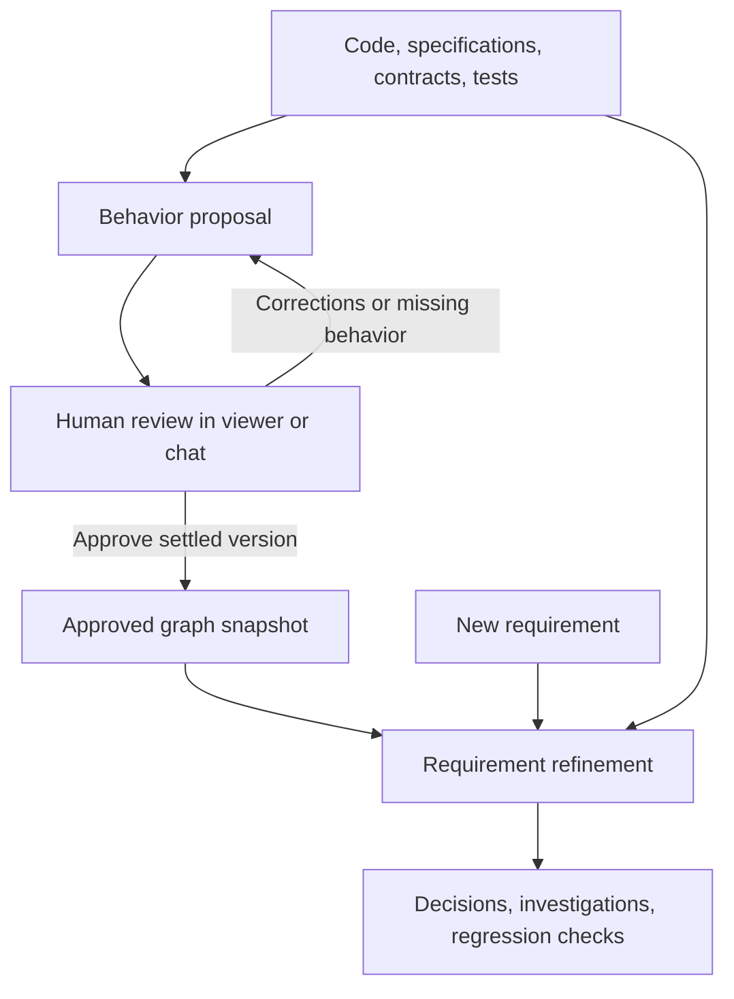

# Maintainer and AI handoff

**Purpose:** preserve the problem, design decisions, research lineage, implementation boundaries, and next work for another developer or AI session.

**Baseline:** reviewed on 2026-11-20 against [commit `20fe0288cc01521a445c289284f3f7af73de4265`](https://github.com/ctrl0alt0del/ai-skills/tree/20fe0288cc01521a445c289284f3f7af73de4265). Recheck the current code before relying on implementation details below. This document records the initial design; the skill instructions, contracts, and implementation must evolve together.

**Implementation update, 2026-11-20:** Requirement Refinement now prescribes two
isolated investigators followed by a fresh evidence judge when the host supports
subagents. Dedicated role guides and a deterministic review helper make the
handoffs explicit and validate their lineage and candidate accounting. The final
report remains schema `1.0`; execution provenance is saved separately. The host
launches the agents; no model API runner has been added.

## Contents

1. [Start here](#1-start-here)
2. [Problem and intended outcome](#2-problem-and-intended-outcome)
3. [Research and prior discussion](#3-research-and-prior-discussion)
4. [Design decisions and their reasons](#4-design-decisions-and-their-reasons)
5. [Current workflows](#5-current-workflows)
6. [Graph semantics and integration contract](#6-graph-semantics-and-integration-contract)
7. [Runtime and source map](#7-runtime-and-source-map)
8. [Verification status and known limits](#8-verification-status-and-known-limits)
9. [Suggested next work](#9-suggested-next-work)
10. [Prompt for the next session](#10-prompt-for-the-next-session)

## 1. Start here

Read this document, then:

1. [Behavior Graph Builder instructions](skills/behavior-knowledge-graph-builder/SKILL.md).
2. Its [graph authoring guide](skills/behavior-knowledge-graph-builder/references/graph-authoring.md), [runtime contract](skills/behavior-knowledge-graph-builder/references/runtime-contract.md), and [chat review guide](skills/behavior-knowledge-graph-builder/references/chat-review.md).
3. [Requirement Refinement instructions](skills/requirement-refinement/SKILL.md).
4. Its [impact relationships](skills/requirement-refinement/references/impact-relationships.md), [edge-case taxonomy](skills/requirement-refinement/references/edge-case-taxonomy.md), and [report contract](skills/requirement-refinement/references/output-schema.md).
5. The relevant implementation files in [section 7](#7-runtime-and-source-map).

The two skills have different responsibilities:

| Skill | Input | Result |
| --- | --- | --- |
| Behavior Graph Builder | Application code, specifications, contracts, tests, and human knowledge | A reusable, reviewed behavior graph with evidence, coverage limits, and approval history |
| Requirement Refinement | A proposed requirement plus available project evidence, optionally including a behavior graph | A prioritized agenda of decisions, investigations, and regression checks |

**Implementation boundary:** these are agent workflows with supporting tools. The AI investigates and reasons according to the Markdown instructions. Python implements structural validation, refinement review handoffs/audits, and, for the builder, review persistence, serving, and export. There is no bundled autonomous repository analyzer, embedding index, DBSCAN pipeline, or general impact-analysis engine.

## 2. Problem and intended outcome

The original problem was the amount of developer, designer, QA, and product discussion needed to decompose a feature and settle its edge cases. An AI should help prepare that discussion by locating relevant behavior and exposing consequential unanswered questions.

Loading more source code does not by itself supply missing business intent. Code may implement an old rule, a test may cover only one scenario, and two features may interact through shared state or an event without calling one another. The useful knowledge therefore includes behavior, conditions, invariants, dependencies, and the authority and freshness of supporting evidence.

The intended sequence is:



The graph is reusable context that helps the refinement agent find a relevant neighborhood without loading the whole application. It is a versioned representation of what has been established and what remains uncertain. Approval does not prove completeness or establish every stated runtime guarantee.

Refinement must also work before a permanent graph exists. It supports repository-backed, documentation-only, and requirement-only analysis, constructing a temporary impact map when useful.

The user's explicit builder requirements were: start a server and an understandable review frontend on first use; allow annotations; revise in one or more rounds; continue through chat when useful; and create the final graph only after the current proposal is settled and approved.

## 3. Research and prior discussion

The original discussion identified the sources below. Their canonical links were reconstructed and checked while writing this handoff; not every original citation URL survived the conversation history. Distinguish research inspiration, related tools, and actual implemented capabilities.

### Primary inspiration: DRILS

Romina Etezadi et al., **[DRILS: Dependency-based Requirement Change Impact Analysis Using LLMs](https://arxiv.org/abs/2610.33920v1)**, arXiv:2610.33920v1, submitted 24 October 2026. [Full text](https://arxiv.org/html/2610.33920v1); [DOI](https://doi.org/10.48550/arXiv.2610.33920).

DRILS accepts requirements, an existing requirement dependency graph, and a change request. It combines Requirement-Enrichment RAG (RE-RAG), DBSCAN grouping, two independent impact generators, and judge consolidation. Its relationship vocabulary includes Requires, Implements, Conflicts, and Details; Conflicts is undirected.

The paper reports average recall of 87.1%, precision of 76.3%, and approximately 81% F1 on three automotive requirement datasets. These are the authors' results, not measurements of these skills. Its replication package is described as forthcoming upon acceptance.

The repository adapts focused context gathering, typed relationships, complementary generation, and separate evidence review. It does not reproduce the paper's model configuration, preprocessing, clustering, confidence scoring, or evaluation. The human-reviewed behavior graph builder and concrete edge-case agenda are project extensions.

### Related research: semantic and structural impact

Momil Seedat, **[Toward Semantically-Seeded, Graph-Propagated Impact Analysis Across Software Artifacts: A Vision](https://arxiv.org/abs/2606.18855)**, 17 June 2026.

This explores combining semantic similarity with decayed propagation over typed artifact dependencies. The reported proof of concept uses five change scenarios in a small payment subsystem. It is relevant to future retrieval experiments, with limited evidence of generalization. No propagation matrix, decay coefficient, or blended ranking formula from this paper is implemented here.

### Potential evaluation resource: Safa

Katherine R. Dearstyne, Jane Cleland-Huang, and Alberto Rodriguez, **[Real-World Traceability Patterns for Generative AI Systems: With Insights from the Safa Dataset](https://doi.org/10.1145/3786174.3788354)**, RAISE '26.

The [official dataset](https://zenodo.org/records/18285767), published 18 January 2026, provides natural-language artifacts and source code associated with the paper. [Dataset DOI](https://doi.org/10.5281/zenodo.18285767). This is a candidate for future evaluation; neither skill has been evaluated against it in the recorded work. Do not confuse it with the older Dronology / SAFA-Artifacts safety-case dataset.

### Related approaches discussed

| Reference | Relevance to this project |
| --- | --- |
| [GitHub Spec Kit](https://github.com/github/spec-kit) | Structured specification and implementation workflows |
| [Codebase Memory MCP](https://github.com/DeusData/codebase-memory-mcp) | Persistent technical code knowledge; a possible future evidence source |
| [Swimm documentation](https://docs.swimm.io/) | Capturing and retrieving codebase knowledge |
| [Ketryx](https://www.ketryx.com/) | Engineering traceability and change-impact workflows |
| Matt Wynne, [Introducing Example Mapping](https://cucumber.io/blog/bdd/example-mapping-introduction/), 8 December 2015 | Organizing refinement around rules, concrete examples, and unresolved questions |

These are references and possible comparison points, not runtime dependencies or existing integrations. Cucumber was part of the earlier discussion; the specific Example Mapping article is useful supporting reading identified for this handoff. An unidentified systematic review was also mentioned earlier; it is deliberately not reconstructed as a specific citation without evidence.

## 4. Design decisions and their reasons

This table records choices expressed by the user or embodied in the current instructions and code. It does not imply that every possible alternative was experimentally compared.

| Decision | Reason and consequence |
| --- | --- |
| Separate graph construction from requirement refinement | A reviewed map can be reused across changes. A single change can still be analyzed without first documenting the whole application. |
| Use business behavior as the main unit | Function names and call edges alone do not capture eligibility, lifecycle, policy, or shared-data assumptions. Technical artifacts remain evidence for behavioral claims. |
| Separate intended, observed, and proposed behavior | A product statement does not prove the implementation; existing code does not authorize policy. Contradictions remain visible. |
| Attach evidence and uncertainty to individual claims | A node can contain both well-supported facts and unknown guarantees. One label for an entire feature would hide that distinction. |
| Preserve stable semantic IDs and source versions | Review notes and downstream references should survive rewording. Versions let a later analysis question freshness instead of trusting a familiar filename. |
| Use typed edges; explain change-specific impact during refinement | The baseline records persistent coupling and conditions. Refinement explains how this particular change could propagate; connectivity alone is insufficient. |
| Traverse incoming as well as outgoing relationships | Shared-state readers and event consumers are often discoverable through incoming edges. Edge direction must retain its meaning. |
| Retrieve focused evidence and maintain an unresolved frontier | Work can continue within context limits without silently losing important unexplored branches. |
| Avoid a fixed hop cutoff or a finding quota | Neither a cluster boundary nor a hop count proves that downstream consequences end there. Real limits must be reported as coverage limits. |
| Use two fresh investigators and a fresh judge | Business and failure analysis expose different omissions without sharing initial candidate answers. A third context checks evidence and consolidates their completed results; agreement between agents is insufficient evidence. |
| Separate decisions, investigations, and regressions | The team should decide undefined policy, investigate missing facts, and test established rules without being asked to approve the same rule again. |
| Preserve unknowns and accepted gaps | Human review can settle how a limitation is represented without inventing knowledge about an inaccessible service. |
| Keep browser and chat review in one session | A modality change should not lose feedback, create contradictory copies, or bypass approval. |
| Require approval of the exact settled proposal | Reviewing an older graph does not authorize a changed graph. One successful round is sufficient. |
| Bundle a standard-library server and standalone frontend | First use can start the review without scaffolding a framework project. Deployment and large-scale collaboration remain separate concerns. |
| Use optimistic version checks for semantic mutations | The agent and reviewer can act concurrently; stale edits must be surfaced and reconciled. |
| Keep agent presence outside semantic review state | A heartbeat should not invalidate human approval. A running server must not imply that an AI is continuously running. |
| Export a complete graph plus index and node records | Consumers can retrieve focused context while retaining a canonical complete representation and provenance. |

**Project boundaries:** mapping and refinement do not automatically implement features, change application business rules, publish tickets, or approve a graph. New automation should preserve those boundaries unless the user's task explicitly expands them.

## 5. Current workflows

### Requirement Refinement

The host's agent tools execute the investigation and judgment roles. The report
validator checks schema `1.0`; `scripts/review_workflow.py` freezes shared context,
checks role artifacts, and produces the final report plus a review audit.

1. **Frame the change.** Preserve the requirement's wording. Extract actors, triggers, entities, transitions, outcomes, constraints, and scope. Keep omitted decisions as questions.
2. **Choose the evidence mode.** Record repository-backed, documentation-only, or requirement-only analysis and the inspected revision when available.
3. **Build an evidence packet.** Read business sources, then relevant implementation, schemas, contracts, tests, UI states, readers, writers, producers, and consumers. Record precise evidence IDs and locations.
4. **Expand the impact neighborhood.** Reuse an available graph or construct a temporary map. For each connection, explain how this particular change could affect an assumption or transition.
5. **Launch two isolated investigators.** Freeze a shared packet with no initial findings. The business investigator covers lifecycle, eligibility, policy, UX, invariants, and inverse operations. The failure investigator covers concurrency, duplication, ordering, partial success, retry, recovery, compatibility, and rollout. Both may inspect authorized sources; neither reads its peer's candidates.
6. **Launch a fresh judge after both finish.** Reopen sources; reject generic checklist items; merge questions about one underlying decision; split independent decisions. Record one explained verdict for every candidate and explicit provenance for judge-added findings.
7. **Classify, prioritize, and deliver.** Produce consistent Markdown and JSON, retain settled constraints, disclose blind spots and unexpanded dependencies, and state why analysis stopped.

Fresh contexts are the default when supported, preferably parallel for the two
investigators. Limited slots can be handled by launching them sequentially in
separate contexts. If isolation is unavailable, explicitly requested otherwise,
or an actual agent failure persists after one fresh retry, start an honestly
labeled `sequential-fallback` run. Separate passes by one agent are not independent
agents; separate contexts also do not establish statistical model independence.

See the [coordinator protocol](skills/requirement-refinement/references/multi-agent-workflow.md)
and the [business](skills/requirement-refinement/references/business-investigator.md),
[failure](skills/requirement-refinement/references/failure-investigator.md), and
[judge](skills/requirement-refinement/references/evidence-judge.md) role guides.

A useful finding has a concrete initial state and action sequence, a plausible connection to the change, and a material consequence:

- `decision`: the expected behavior is unsettled.
- `investigation`: missing or conflicting evidence blocks a conclusion; specify what to inspect.
- `regression`: an established expectation needs a check.

Priorities are `blocking`, `design`, and `follow-up`, each with an explanation. Owner suggestions are roles. There are no calibrated numerical confidence or risk scores.

The [taxonomy](skills/requirement-refinement/references/edge-case-taxonomy.md) activates relevant dimensions. It is not an instruction to produce one question for every category.

### Behavior Graph Builder

The agent initializes a separate review directory and starts the server before lengthy investigation. It authors a proposal from the available evidence, validates it, and submits it to the session. The runtime does not extract the graph from code.

The review cycle is:

1. Present scope, the proposal, and material uncertainties.
2. Save browser or chat annotations against the graph, a node, a dependency, or an individual claim.
3. Respond to submitted feedback with an explanation or a revised proposal.
4. Give each note a visible disposition: `addressed`, `accepted_gap`, or `rejected`, with a reason. Acceptance of a gap requires actual user agreement.
5. If graph content changed, submit a new round. If only explanations were needed, use `complete-review` to clear the request without inventing another graph round.
6. Obtain actual user approval of the complete current proposal, including its listed limitations.
7. Export through the guarded command and verify the output.

A new proposal retains annotations and snapshots. It reopens resolved notes whose directly referenced target changed or disappeared; graph-level notes reopen when graph content changes. An identical proposal does not reopen them. New proposals and semantic feedback changes invalidate earlier approval.

Approval requires no open notes and no pending review request. It records the round, graph digest, and review-state digest. Export rechecks these and the expected state version. The agent must not approve on the user's behalf. Recorded chat text and a conversation reference document approval; they do not cryptographically authenticate a human identity.

### Live feedback and chat continuation

The viewer saves data to the same SQLite session used by the CLI. It does not invoke an LLM.

While the host keeps the agent active, `wait --after-version N --timeout 20` returns when review state changes or the timeout expires. The supported timeout is 0–30 seconds; zero provides a nonblocking presence pulse. Presence expires after 35 seconds and does not increment `state_version` or alter approval. `disconnect` clears it. The skill pauses after three idle waits instead of polling indefinitely.

Submitted feedback sets `review_requested`. Saving an individual note is not necessarily a signal that the reviewer has finished. Once the agent pauses, the user can return to chat to resume the existing session.

If a usable viewer cannot be reached, continue in chat and explain the limitation. If the runtime itself is unavailable, preserve draft discussion and defer final export until its validation and approval checks can run. A cloud-local localhost address is not automatically reachable from the user's computer.

## 6. Graph semantics and integration contract

### Behavior graph

The authoritative format is documented in the [runtime contract](skills/behavior-knowledge-graph-builder/references/runtime-contract.md) and enforced by `validate_graph` in [graph_model.py](skills/behavior-knowledge-graph-builder/scripts/graph_model.py).

The schema version is `behavior-graph/1`. Its root records contain `project`, `nodes`, `dependencies`, `evidence`, and `coverage`.

- **Nodes:** stable IDs, readable titles and summaries, domains, aliases, owner roles, and claims. Kinds: behavior, state, event, rule, requirement, interface, configuration.
- **Claims:** perspective (`intended`, `observed`, `proposed`), basis (`supported`, `inferred`, `unknown`), statement, aspect, and evidence references.
- **Dependencies:** endpoints, relationship, rationale, conditions, basis, and evidence references. Supported dependencies require evidence; dependency basis is supported or inferred.
- **Evidence:** source identity, kind, location, and summary.
- **Coverage:** checked material, blind spots, unexpanded areas, and conflicts.

Stable graph IDs use lower-case semantic identifiers. The validator checks uniqueness, allowed values, required fields, and reference integrity; it rejects unexpected fields. Consult the implementation before extending the schema.

The shared relationship vocabulary is:

`requires`, `implements`, `details`, `conflicts`, `reads`, `writes`, `emits`, `consumes`, `reverses`, `enforces`, `exposes`, `configured_by`.

The [relationship guide](skills/requirement-refinement/references/impact-relationships.md) defines every direction. For example:

- Writer → state via `writes`; reader → state via `reads`.
- Producer → event via `emits`; consumer → event via `consumes`.
- Reversal → forward operation via `reverses`.
- Dependent behavior → prerequisite via `requires`.

To discover affected consumers, traverse incoming `consumes` edges without reversing their stored meaning. Likewise, readers are found through incoming `reads`. A change explanation may therefore use edges that do not form a single forward-directed path. Conflict analysis considers both sides even though JSON records have `from` and `to`.

Conditions and invariants are recorded text. There is no symbolic execution or model checking of them.

### Refinement report and the current integration boundary

The [report schema](skills/requirement-refinement/references/output-schema.md) is version `1.0`. Its root contains `requirement`, `analysis`, `evidence`, `dependencies`, `findings`, `settled`, and `coverage`, plus `schema_version`.

Evidence, dependency, and finding IDs are report-local `E-001`, `D-001`, and `Q-001` identifiers. Dependency endpoints are descriptive strings, not references validated against a report node registry.

**Integration is currently agent-mediated.** The refinement agent reads the builder's index and relevant node/dependency records, checks supporting sources and freshness, and constructs its own report. No importer, automatic conversion, or end-to-end compatibility suite is bundled.

| Builder graph | Refinement report | Consequence for future integration |
| --- | --- | --- |
| Persistent semantic IDs | Report-local E-/D-/Q- IDs | Preserve a traceable ID mapping |
| Evidence `source_id` and multiple source snapshots | No evidence `source_id`; one analysis revision string/null | Design explicit provenance preservation |
| `human-feedback` evidence kind | That kind is not accepted | Do not silently recast human assertions as implementation proof or approved specifications |
| Dependency `conditions` | No conditions field | Preserve applicability without dropping meaning |
| Coverage `conflicts` array | No dedicated conflicts array | Represent disagreements as evidence and findings |
| Claim-level perspective and basis | Findings have basis; perspective is conveyed in statements/evidence | Keep policy, implementation, and proposals distinguishable |

Copying graph records directly into the report will fail or lose meaning. Both validators reject unexpected fields, so additions require a deliberate compatibility or versioning decision.

### Refinement review artifacts

The multi-agent workflow adds separate envelopes without changing report `1.0`:

| Artifact | Purpose |
| --- | --- |
| `refinement-review-packet/1` | Frozen common context, actual coordinator identity, execution mode, run ID, and canonical digest |
| `refinement-investigation/1` | One business or failure report bound to that packet, with its actual host actor ID |
| `refinement-judge-input/1` | Both completed investigations and their digests, assembled only after validation |
| `refinement-judgment/1` | Final report, candidate verdicts, judge additions, and source-check records |
| `refinement-review/1` | Retained packet, investigations, judgment, execution mode, and digest audit |

Each investigator's E-/D-/Q- identifiers are local. The judge uses qualified
candidate references such as `business:Q-001` and `failure:Q-001`, then creates
a coherent final evidence/dependency ledger. Every candidate receives exactly
one explained disposition; every final finding maps to candidates or an explicit
judge addition. Shared findings require merge labeling, with an explicit revision
for a candidate that also splits into multiple findings.

The helper detects stale inputs, missing verdicts, incorrect mappings, reused
declared actor IDs in isolated mode, and missing source-check records. Actor IDs
and source checks are recorded declarations, not proof of real context isolation
or source truth. The coordinator must actually launch the agents using the host.

`finalize` creates `refinement.json` and `review.json` in a new directory. This
refinement audit has a different schema and purpose from the graph builder's
file of the same name. The coordinator renders Markdown from the judge's report;
substantive changes return to the judge rather than bypassing the review.

### Exported artifacts

| File | Role |
| --- | --- |
| `graph.json` | Canonical complete graph |
| `index.json` | Compact lookup with node record paths |
| `nodes/node-<id>.json` | Individual node records for selective retrieval |
| `dependencies.json` | Typed relationships |
| `evidence.json` | Evidence records |
| `coverage.json` | Scope and known limitations |
| `review.json` | Approval, annotations, round metadata, source metadata, and audit events |
| `manifest.json` | Artifact hashes and graph identity |

Complete past graph snapshots remain in the review SQLite database. The export does not reproduce each past round as a separate full graph file. Keep the session when later review or historical comparison is needed.

## 7. Runtime and source map

| File | Responsibility |
| --- | --- |
| [builder SKILL.md](skills/behavior-knowledge-graph-builder/SKILL.md) | Agent orchestration and human review rules |
| [graph-authoring.md](skills/behavior-knowledge-graph-builder/references/graph-authoring.md) | Behavioral modeling, evidence, scope, and downstream use |
| [runtime-contract.md](skills/behavior-knowledge-graph-builder/references/runtime-contract.md) | Graph, state, API, CLI, and export contracts |
| [chat-review.md](skills/behavior-knowledge-graph-builder/references/chat-review.md) | Same-session review through chat |
| [graph_model.py](skills/behavior-knowledge-graph-builder/scripts/graph_model.py) | Validation, canonical hashes, SQLite state/audit, concurrency, approval, export |
| [graph_review.py](skills/behavior-knowledge-graph-builder/scripts/graph_review.py) | CLI and HTTP routes over the same Store |
| [review.html](skills/behavior-knowledge-graph-builder/assets/review.html) | Standalone DOM/SVG viewer and review controls |
| [example-graph.json](skills/behavior-knowledge-graph-builder/assets/example-graph.json) and [example-sources.md](skills/behavior-knowledge-graph-builder/assets/example-sources.md) | Fictional runtime demonstration; never evidence about a user's application |
| [refinement SKILL.md](skills/requirement-refinement/SKILL.md) | Evidence retrieval, impact exploration, scenario generation, consolidation |
| [refinement references](skills/requirement-refinement/references) | Relationship semantics, scenario taxonomy, report schema |
| [validate-report.py](skills/requirement-refinement/scripts/validate-report.py) | Strict report structure and reference validation |
| [multi-agent-workflow.md](skills/requirement-refinement/references/multi-agent-workflow.md) | Fresh-context orchestration, artifact contracts, bounded recovery, and honest fallback |
| [business-investigator.md](skills/requirement-refinement/references/business-investigator.md), [failure-investigator.md](skills/requirement-refinement/references/failure-investigator.md), [evidence-judge.md](skills/requirement-refinement/references/evidence-judge.md) | Dedicated task guides for the three roles |
| [review_workflow.py](skills/requirement-refinement/scripts/review_workflow.py) | Frozen packets, role/judge artifact validation, candidate accounting, and final report/audit output |
| [test_refinement_review.py](tests/test_refinement_review.py) | Reproducible regression checks for the refinement artifact workflow |
| Both `agents/openai.yaml` files | Skill display and invocation metadata |

Builder runtime details that matter when modifying it:

- Python 3.10+ and the standard library; standalone frontend assets.
- A separate session directory containing `review.sqlite3`; do not put mutable reviews inside the installed skill.
- SQLite WAL, round snapshots, audit records, and optimistic `state_version` checks. Semantic writes use `BEGIN IMMEDIATE`.
- Server routes expose state, health, rounds, annotations, resolution/reopening, review requests, and approval. CLI operations also author proposals and export.
- The frontend polls full state every 3.5 seconds. Its initial layout groups node kinds into three columns; it is not a semantic-clustering or force-directed implementation.
- Unsubmitted note drafts live in browser session storage; submitted notes live in SQLite. Stale edits return a conflict, preserve the text, load current state, and require deliberate retry.
- Loopback is the default. Host/Origin checks, CSRF protection, JSON-only mutations, and named routes limit access. The server does not serve arbitrary project files.
- `--allowed-origin` supports an already trusted preview proxy. It is not authentication; user accounts and public hosting are outside the current runtime.
- Export stages files and publishes a new directory by rename. It refuses existing destinations. Filesystem publication and the SQLite receipt are separate operations, so crash recovery needs explicit testing.

### Small local checks

Run these from the repository root; use the available Python interpreter, such as `py -3` on Windows:

```bash
python3 skills/behavior-knowledge-graph-builder/scripts/graph_review.py --help
python3 skills/behavior-knowledge-graph-builder/scripts/graph_review.py validate --graph skills/behavior-knowledge-graph-builder/assets/example-graph.json
python3 skills/requirement-refinement/scripts/validate-report.py --help
python3 skills/requirement-refinement/scripts/review_workflow.py --help
python3 -m unittest discover -s tests -p 'test_refinement_review.py'
```

Validate a newly produced refinement report with:

```bash
python3 skills/requirement-refinement/scripts/validate-report.py /absolute/path/to/refinement.json
```

For a viewer check, initialize a new temporary session and serve it using the commands in the builder skill. Submit only the bundled fictional example or another explicit fixture. Do not manufacture approval in a real project session to exercise export. Do not assume an environment-specific local path, port, process handle, or preview URL from an earlier chat is still usable.

## 8. Verification status and known limits

### Evidence available at the baseline

| Status | What is established |
| --- | --- |
| Inspectable in this repository | Both workflows, strict validators, builder runtime/frontend, a fictional graph fixture, and the refinement role/artifact workflow with regression tests |
| Checked again while preparing this handoff | Source layout and contracts, Python/JavaScript syntax, and validation of the bundled graph |
| Checked for the investigator/judge update | Refinement artifact tests, including the complete CLI sequence and compatibility with the existing report validator; stale-input, role, candidate-accounting, source-check, fallback, and output-preservation gates |
| Reported by the original development session | Isolated checks for malformed input, reference integrity, restart persistence, concurrent edits, stale writes, annotation reopening, approval invalidation, export gates/manifests, HTTP guards, and nonsemantic presence |
| Reported by the original development session | A small fictional booking/cancellation trial produced an initial proposal with open questions and stopped before final export |
| Not established | A repeatable builder test suite or CI; a successful live browser walkthrough; benchmark precision/recall or exhaustive edge-case coverage; automatic graph-to-report interoperability |

The historical builder checks and booking trial were development exercises. Their
temporary harnesses and fixtures are not committed here. The newly committed
refinement tests cover artifact mechanics; they do not replace a behavioral
evaluation corpus or establish that agents reason accurately.

The original browser walkthrough was blocked by the available environment's reachability and browser restrictions. Static JavaScript checks and HTTP tests do not establish visual layout, usability, keyboard operation, or a working private-preview deployment.

### Limits to preserve honestly

- **Schema validity is structural.** Validators do not prove source truth, evidence relevance, policy authority, freshness, completeness, or Markdown/JSON agreement.
- **Freshness is manual.** Source revisions are recorded metadata; no watcher or incremental extractor keeps the graph synchronized with code.
- **Annotation reopening is target-local.** An evidence or source-revision change may leave a referring claim object unchanged, so its resolved note will not automatically reopen on that basis alone.
- **Approval records are not identity infrastructure.** Chat approval authenticity depends on the agent faithfully recording the actual user statement.
- **Export is not a cross-filesystem/database atomic transaction.** A crash after directory publication but before the database commit can leave files without a receipt; a crash can also leave an export lock.
- **Scale is unmeasured.** Whole-state polling, whole-state JSON storage, and the current layout may become costly or crowded. Per-node export helps consumers but does not provide paginated/subgraph runtime queries.
- **External boundaries remain uncertain.** A producer's code cannot establish an inaccessible consumer's behavior.
- **No autonomous background model is bundled.** Presence only indicates an active agent wait. Server availability follows the host process and environment lifetime.

## 9. Suggested next work

These are proposed continuation tasks, not already implemented features or instructions to expand every task at once.

### Priority 1: make current behavior reproducible

1. **Extend regression coverage and add CI.** Refinement artifact gates now have committed tests. Add reproducible builder coverage for invalid references, unresolved notes, pending review, exact-version approval, new-feedback invalidation, changed/removed target reopening, identical proposals, concurrent writes, restart persistence, stale browser edits, heartbeat isolation, HTTP access checks, and export hashes. Use isolated fixtures rather than user approval records.
2. **Exercise the real browser workflow.** Verify a supported local/private-preview launch, readable graph and list views, annotations, stale-edit recovery, review requests, approval, responsive layout, keyboard interaction, and chat resumption.
3. **Test export crash recovery.** Simulate interruption around publication and receipt persistence. Define how to recover an orphaned output directory or stale lock without overwriting a valid export.

Success means a new contributor can reproduce the relevant checks from a clean checkout and can distinguish a failed gate from an environmental limitation.

### Priority 2: make reuse reliable

4. **Specify and test the graph-to-refinement adapter.** Preserve graph identity, evidence locations and revisions, conditional applicability, human feedback, and report-local IDs. Decide whether mapping fits the existing report schema or needs an explicit new version.
5. **Define source-change invalidation.** Decide what source/evidence edits mark claims stale, reopen review, or require renewed investigation. Link source changes to affected claims instead of relying solely on direct target-object differences.
6. **Build a small reviewed evaluation corpus.** Include shared-state readers, event consumers, partial cancellation/refund, approved rules that should become regression checks, contradictory documents/code, missing external contracts, and requirement-only input.

Evaluate missed consequential cases, unsupported findings, correct classification, traceable evidence, and human usefulness. Separate behavioral quality from JSON validity. Measure token/time cost if comparing retrieval strategies. Do not reuse the DRILS paper's metrics as a proxy.

### Priority 3: add complexity only against a demonstrated need

7. Measure graph size, review latency, and context cost before introducing subgraph APIs, incremental extraction, semantic search, or richer graph diff views.
8. Evaluate clustering or semantic-plus-structural retrieval against the current focused-search baseline. Domain grouping is not DBSCAN, and a promising research result does not establish the right parameters for this application.
9. Consider additional evidence adapters, code indexes, or graph storage only when they improve a measured workflow. Human approval, provenance, and visible uncertainty still need to survive the integration.

For any schema or state-machine change, update the validator, contract, agent instructions, example data, frontend/export consumers, and regression checks together. Do not add fields that downstream strict validators silently cannot accept.

## 10. Prompt for the next session

> Work in this repository and read HANDOFF.md, both SKILL.md files, and the contracts relevant to the requested change. Inspect the current implementation before assuming the handoff is up to date. Explain the concrete problem, choose one bounded improvement, and preserve evidence provenance, intended/observed/proposed distinctions, shared browser/chat review state, and approval of the exact settled graph. Treat research ideas and historical test reports as context, not implemented or freshly verified behavior. Make the requested change, run the checks that address its actual risks, update affected contracts/examples, and report what changed and what remains unverified.

This handoff should be maintained when a design decision changes, a limitation is resolved, an integration becomes executable, or new evaluation evidence becomes available.
